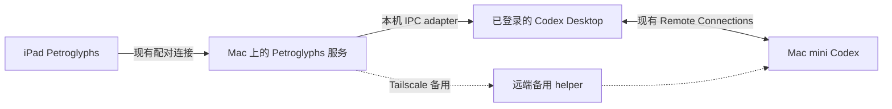

**Petroglyphs 直接使用 Codex Remote Connections：可行性调查**

调查日期：2026-10-15，美国中部时间。最后的 IPC 实验时间为 2026-10-16 04:06 UTC。

结论：应优先开发“Petroglyphs 的 Mac 服务复用已运行 Codex Desktop 的 Remote Connections”。本轮已经从独立进程读取到 Mac mini 指定聊天的完整历史回复，并与 Codex 的读取工具核对全文哈希。发送图片存在明确的内部调用链，但未执行发送。完整聊天目录和远端文件落盘仍有外部接入缺口。因此，已有可运行的读取原型和发送路径依据，还不能宣布整个功能已完成。

Tailscale 保留为备用传输。它不是现有 relay 的前置条件。此前“CLI 没有对应参数，所以必须部署 Tailscale helper”的判断范围过大，需要撤回。

**建议架构**

这条主路径继续由 Desktop 持有认证和 Remote Connections 会话。Petroglyphs 不需要复制 Desktop token，也不需要取得其设备私钥。iPad 到这台 Mac 的配对连接仍然存在；Mac 到 Mac mini 的传输使用 Codex 的远端通道。此方案要求中间这台 Mac 和 Desktop 在线。iPad 完全脱离这台 Mac 的方案，需要独立 controller，见下文。

**证据强度与版本**

| 对象 | 本次基准 | 能证明什么 |
| --- | --- | --- |
| 当前 Desktop | `/Applications/ChatGPT.app`，bundle `com.openai.codex`，`26.1007.71326`，build `20398` | 当前已安装产品的真实代码路径 |
| Desktop bundled CLI | `0.162.0-alpha.17.2` | 匹配当前产品的 app-server 类型 |
| 对应公开源码 | commit `740e5af33c71225640e0c1c1555c514c2c93ab74` | 可核查的 host/RPC 实现；未声称二进制可复现一致 |
| Homebrew CLI | `0.161.0` | 仅解释早先 CLI 探测结果，不能代表当前 Desktop 全部能力 |
| 本机 IPC 探针 | 独立 Python 进程，身份 `petroglyphs-readonly-research` | 外部进程能够调用读取接口并收到目标聊天数据 |
| iPad → relay → 新回复 | 本轮未执行 | 不能作为已完成产品功能报告 |

当前 `app.asar` SHA-256：`2f231a64e6dd30111bcd09e03c149cd06c8679b25914842772423251c4608ded`。

官方版本依据：[Desktop tag](https://api.github.com/repos/openai/codex/git/tags/f04373e4fb0767b92277665293da747bcc0cb27c)。安装包调查和官方资料调查的本机报告早于最终 IPC 结果，集成路线排序以本文为准。原始报告和验收记录保留在本机，不随公共仓库发布。

**已经实际验证的 Desktop 入口**

现有 IPC socket 位于 `~/.codex/ipc/ipc.sock`。本轮先确认目录和 socket 属于当前用户，权限分别为 `0700` 和 `0600`，然后连接已有 router。没有启动替代 router，没有修改权限。消息使用 4 字节小端长度加 JSON。

探针以自己的名称完成 `initialize`。只调用以下读取方法：

- `thread-owner-discovery`
- `thread-follower-read-model-settings`
- `thread-follower-load-complete-history`

读取历史期间还发送了 `thread-stream-following-changed` 的订阅和取消订阅广播。订阅只用于接收状态，不启动模型回合。所有探针均已退出。

| 实验 | 结果 | 解释 |
| --- | --- | --- |
| 本地目标聊天 owner discovery、读取设置 | 成功 | 验证探针身份和 framing 正确 |
| 3 个 Mac mini 聊天 owner discovery | `no-client-found` | 这个 discovery 分支不能作为远端不可用的判断 |
| 绕过 discovery，直接携带 remote `hostId` 读取两个聊天设置 | 全部成功 | `thread-follower-*` 的实际路由支持远端 host |
| 订阅并读取 Mac mini 的指定测试聊天 | 成功，收到 2 个约 131 KB 的 snapshot | 包含该聊天的 3 个回合和助手正文 |
| 与 `read_thread` 独立核对助手文本 | 8/8 SHA-256 一致 | 包含 1230 字符和 1191 字符的完整最终回复，不只是摘要 |
| 同一 threadId 配不存在的 hostId | `no-client-found` | 本次负对照没有退回本地主机或忽略 hostId |

实验固定了一个远端 host 和一个测试聊天。具体标识仅保留在本机验收记录中。

原因已定位：当前 renderer 的 owner discovery 注册限制了 host，而 follower handler 读取请求 frame 的 `hostId`，再交给对应 host 的 view service。对非本地主机，follower 方法的协议版本比基础版本加 1。只测试 discovery 会得到错误的不可行结论。

历史返回通过 `thread-stream-state-changed`，包含 `hostId`、`conversationId`、revision，以及 snapshot 或 patches。完整历史请求本身主要返回 revision；实现时需要先订阅，再等待相应 revision 的数据。

这些结果证明了“独立进程 → 当前 Desktop → 指定远端聊天历史”的读取能力。历史可能命中 Desktop 已加载状态；本轮没有强制断开连接、清空缓存或创建新回合，所以它不证明实时网络重连和新回复流已经通过。

精简实验记录、原始历史结构与哈希、全文比对结果均保留在本机。它们包含私有聊天元数据，因此不随公共仓库发布。公开仓库中的测试使用合成 fixture，不替代这些真机验收记录。

**发送、图片与文件的代码路径**

当前内部 IPC 注册了 `thread-follower-start-turn`。它接收指定 conversationId 和 turnStart，并调用对应 host manager 的 `startTurn`。还存在 queued follow-up、steer、approval 和 user-input 的相关方法。本轮没有调用任何发送、队列变更或审批方法。

Desktop 的远端图片处理支持把 PNG 编为 `data:image/png;base64,...`，放入 `UserInput.image`。它也支持先上传文件，再使用目标机的绝对路径。对应的公开类型确认了 `image` 和 `localImage` 两种输入。[UserInput 契约](https://github.com/openai/codex/blob/740e5af33c71225640e0c1c1555c514c2c93ab74/codex-rs/app-server-protocol/src/protocol/v2/turn.rs#L425-L474)

需要区分两项验收：

| 用户需要的结果 | 底层已经存在的能力 | Petroglyphs 的剩余验证 |
| --- | --- | --- |
| 远端模型看到画布内容 | 带图片字节的 image input 经 relay 送达 | IPC turnStart 的正确参数、目标聊天、实际图像内容识别和完整回复 |
| PNG 或任意文件实际保存在 Mac mini | 目标 requestClient 执行 `fs/createDirectory`、`fs/writeFile` | 找到适合外部 adapter 的上传入口，远端读回并比较 SHA-256 |

不能把“模型看到了图片”直接当作“远端存在指定 PNG 文件”。当前 Desktop 的上传对象持有目标 host 的 requestClient，并使用目标 `codexHome`；因此 Mac 本地路径也不能直接作为远端附件路径。

`fs/writeFile` 的公开参数是目标绝对路径和 base64 字节。[文件协议](https://github.com/openai/codex/blob/740e5af33c71225640e0c1c1555c514c2c93ab74/codex-rs/app-server-protocol/src/protocol/v2/fs.rs#L7-L40)。实际处理器执行受信客户端的文件操作；不能假设 turn sandbox 自动限制它。adapter 必须固定上传目录。[文件处理器](https://github.com/openai/codex/blob/740e5af33c71225640e0c1c1555c514c2c93ab74/codex-rs/app-server/src/request_processors/fs_processor.rs#L64-L94)

**完整功能还缺什么**

| 能力 | 当前判定 | 具体缺口 |
| --- | --- | --- |
| 读取指定 remote chat 的已有回复 | 已实测 | 还需接入 iPad UI；本轮没有安装新版本 |
| 发图到固定 remote chat | 有明确代码路径，未发送验证 | turnStart 参数、busy 行为、图片内容和结果关联 |
| 查询全部 remote hosts/chats，搜索、分页 | relay RPC 支持；外部 Desktop IPC 入口未找到 | 已检查的 coordination handler 集合没有通用 `thread/list` 或 host catalog handler |
| 远端保存图片和任意文件 | Desktop 及 host RPC 支持 | 已检查的 coordination handler 集合没有通用 `fs/writeFile` handler |
| 接收新回复增量和最终状态 | 已取得 snapshot，代码支持 patches | 实时生成、断线恢复、序号缺口与终态仍未测试 |
| 用户切换聊天后不串目标 | 协议包含 host/thread，负对照通过 | 每次发送仍须持久化 hostId、threadId、submissionId、turnId |
| 权限请求与工具调用 | Desktop 已有处理链 | 验证 adapter 不改变原聊天权限，不抢走既有工具调用 |

调查时的 Petroglyphs [remote-hosts.ts](../../src/remote-hosts.ts) 只从 Desktop cache 发现 host ID，真正的列表和提交仍转发到配置的 helper。cache 不能提供完整实时远端聊天目录，也不能把 cached host 标成在线。本轮没有修改这段实现。

因此，IPC 适配器值得优先开发，但“远端完整聊天列表”和“文件上传入口”是整个方案的验收门槛。不能用最近打开的聊天缓存替代用户要求的全部远端聊天，也不能把 agent 工具调用接口伪装成通用后台 API。

**为什么普通 CLI 或 SDK 不能直接解决**

`--remote` 对应的公开客户端只封装直连 WebSocket 或 Unix socket。Remote Connections 还在外层包含 environment/stream 路由、controller 身份、分段、确认和重连。普通 `ws://` 地址或 envId 不能互换。[匹配版本的 direct client](https://github.com/openai/codex/blob/740e5af33c71225640e0c1c1555c514c2c93ab74/codex-rs/app-server-client/src/remote.rs#L72-L112)

公开仓库的 host 端会把合法 relay stream 转交 app-server RPC dispatcher，因此 `thread/list`、文件操作和 turn API 都能在这条通道工作。[Relay host 协议](https://github.com/openai/codex/blob/740e5af33c71225640e0c1c1555c514c2c93ab74/codex-rs/app-server-transport/src/transport/remote_control/protocol.rs#L105-L192)、[stream 转发](https://github.com/openai/codex/blob/740e5af33c71225640e0c1c1555c514c2c93ab74/codex-rs/app-server-transport/src/transport/remote_control/client_tracker.rs#L133-L205)

本次在匹配版本、后续 main、官方文档和 SDK 中，没有找到完整 controller enrollment、配对、环境目录和认证续期的公开 SDK。这是支持契约缺口，不能据此推断技术不可实现。App Server 文档对直连 WebSocket 的 experimental 标注也不能当作官方 Remote Connections 产品不可用的证据。[App Server 文档](https://learn.chatgpt.com/docs/app-server#protocol)

**独立 controller 是第二条研发路线**

如果 Desktop IPC 无法满足目录和上传需求，可以研究让 Petroglyphs 成为独立 controller，继续使用同一个官方 relay。这个 controller 可以先运行在 Mac 服务内，后续再考虑直接放到 iPad。远端继续使用原有 Codex host，不必为了 relay 新装 Petroglyphs HTTP helper。

当前安装包包含完整的候选注册流程：账户认证、新设备密钥、浏览器 OAuth step-up、enrollment、refresh、WebSocket challenge 和逐机 PIN pairing。新 controller 需要自己的 clientId、自己的设备 key 和自己的主机授权。当前实现兼容 account-wide 与逐机授权模式，不能假设它自动继承 Desktop 的四台连接。

关键未知是服务端接纳：Desktop 使用固定的第一方 native OAuth client。没有证据证明第三方 client 可以申请所需 scope，或满足可能的 allowlist/attestation 策略。代码里没有某个 attestation 字段，不等于服务端没有限制。公开 Sign in with ChatGPT 的身份/inference OAuth 也不自动授予现有聊天或 relay 权限。[官方 SIWC 说明](https://developers.openai.com/siwc/token-sharing-open-source)

所以这条路线是可设计的协议原型，尚未达到可交付状态。本轮没有注册 controller、调用设备 key、读取 token 或进行 PIN 配对。

**官方 Plugin 方案的适用范围**

MCP App 可以作为官方客户端里的画布，并向当前聊天发消息。但 iOS 的 `ui/message` 目标只支持 active chat；规范没有任意 threadId/hostId 的目标字段。桌面端支持的新聊天目标也不等同于任意现有远端聊天。这个方案会改变现有独立 iPad App 的使用方式。[固定版本的扩展规范](https://github.com/openai/mcp-extensions/blob/0d606217705e0e71eb21fff009619b67b80611dc/docs/spec.md#prompt-target-and-send-behavior)

因此它可以作为另一种产品形态，不能直接承诺满足当前“画布旁搜索并固定任意 remote chat”的需求。

**建议的实施顺序与通过标准**

1. 先把已验证的只读 IPC 适配成独立 transport，保留现有 iPad API 和每次发送固定目标的数据结构。校验 Desktop 版本，连接失败时明确报告不可用。
2. 解决完整 host/chat catalog 的接入，验证搜索和分页覆盖未打开过的远端聊天。只读缓存可加速显示，但不能冒充完整目录。若合法 Desktop 接口无法满足，再验证独立 controller 正常注册能否通过。
3. 对一个明确选定的测试聊天验证小 PNG 的 image input、同一 turn 的内容回复，以及忙碌聊天的排队语义。不能仅以请求成功或入队 receipt 判定完成。
4. 对“远端文件”单独验证上传接口，写入指定临时目录，远端读回比较 hash。随后验证任意文件与大图的尺寸边界。
5. 验证断线重连、完整回复恢复和跨 transport 防重复。成功标准是同一 submission 最多产生一次预期投递，回复始终对应原 host/thread/turn。
6. 最后安装 iPad 版本，真实操作搜索、选择、绘图、发送和阅读回复。

Tailscale fallback 只在主路径明确不可用时启用。若发送已经发出但确认丢失，必须先查原目标的 submission/turn，再决定是否重试。直接换备用通道再发一遍，可能让同一张图执行两次。读取请求可以更早切换，发送请求需要保留这个不确定状态。

上述是后续开发方案，本轮没有实施或部署。现在无需把远端 helper 当作前置工作。

**调查范围与限制**

本轮检查了两个真实仓库的现有路由、当前 Desktop 的 main/shared/renderer/remote settings 代码、bundled CLI 协议、匹配版本的公开 Rust 源码和官方 Plugin 文档。执行了有方法白名单的 IPC 读取探针和一次全文 hash 比对。没有发送新消息、重发图片、修改远端配置或更换 iPad App。

REA 全包扫描遇到一个无关 unpacked `permissions.node` 的摘要不匹配，后续扫描连接关闭，未生成完整 graph。结论来自精确的 JS 成员读取、版本化公开源码和独立 IPC 实测，不声称完成了全包完整性或 native key 审计。

最终决策：主方案优先复用 Desktop 现有 Remote Connections；独立 controller 作为接口不足时的第二研发候选；Tailscale 保持备用。下一轮最有价值的工作是补齐目录和上传入口，并完成一次经授权的真实发图闭环。
